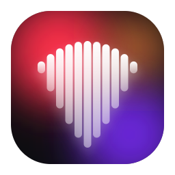
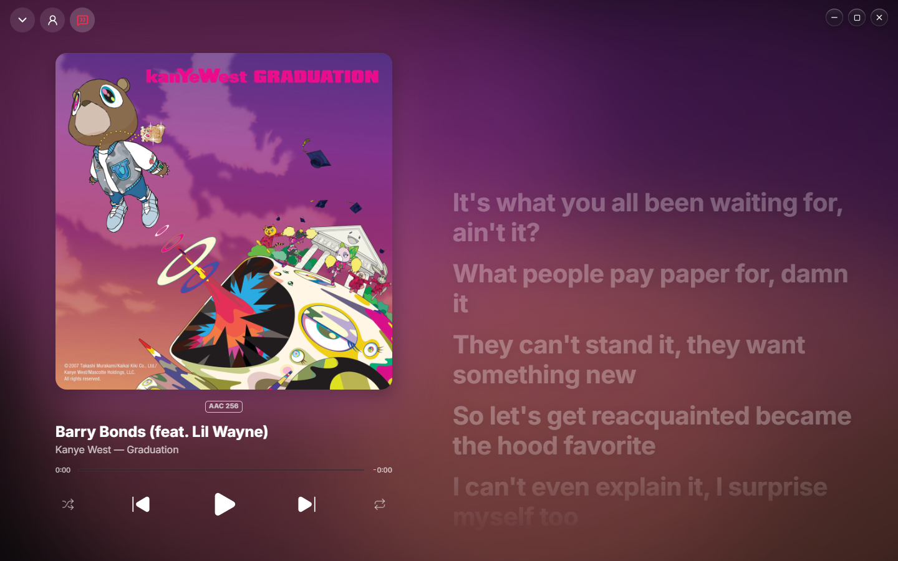
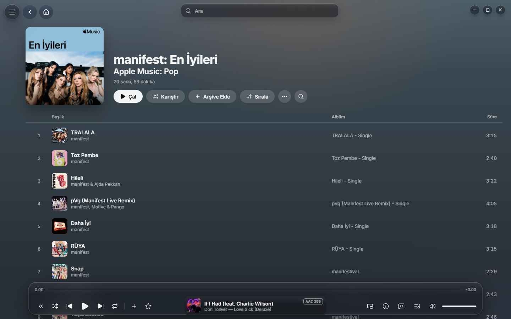
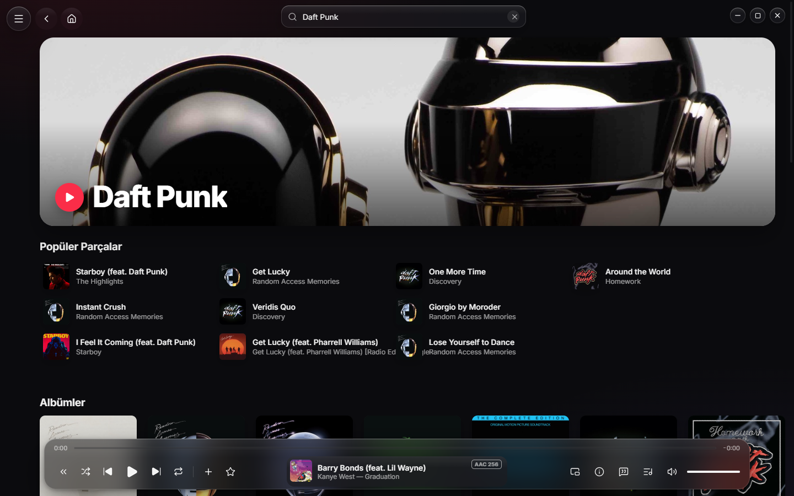
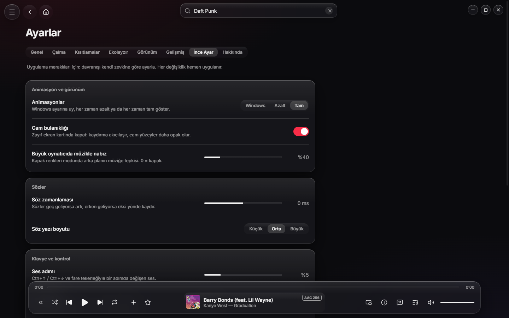
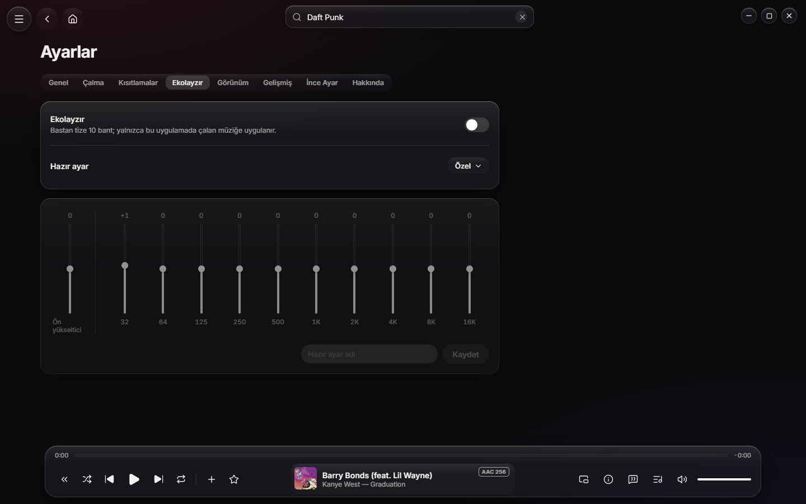

<p align="center">
  
</p>

<h1 align="center">Riff Client</h1>

<p align="center">
  A fast, modern Apple Music desktop client for Windows.<br />
  <sub>Unofficial · not affiliated with, endorsed or sponsored by Apple Inc.</sub><br />
  <sub><b>Source-available, not open source</b> — all rights reserved. You may read the code; you may not use it.</sub>
</p>

<p align="center">
  <a href="#english">English</a> · <a href="#türkçe">Türkçe</a>
</p>

<p align="center">
  
</p>

<table>
  <tr>
    <td></td>
    <td></td>
  </tr>
  <tr>
    <td></td>
    <td></td>
  </tr>
</table>

---

## English

Riff Client brings your Apple Music subscription to Windows with a liquid-glass interface, smooth
motion and a focus on speed. You sign in with your own Apple ID; everything plays from your own
subscription.

### Features

- **Your whole Apple Music** — Home recommendations, New, Radio (live stations and genres), search
  with top results and suggestions, catalog albums, artists and playlists.
- **Your library** — Recently Added, Artists, Albums, Songs, Genres, Composers, Compilations and all
  of your playlists, with per-playlist sorting. Add to library, favourites, new playlists, Play Next /
  Play Later.
- **Full-length playback** with Widevine DRM (castlabs ECS), 256 kbps AAC, editable Up Next with
  autoplay, shuffle and repeat, Windows media keys and media overlay.
- **Full-screen player** — album-colour backdrop that pulses with the music, time-synced lyrics,
  artist-photo mode, quality badge.
- **MiniPlayer** — a square, optionally always-on-top artwork window.
- **Song info** — credits (writers, producers, performers, engineers) and samples from MusicBrainz,
  artist summaries from Wikipedia.
- **10-band equalizer** with presets and per-song presets.
- **Tweaks** for enthusiasts — motion, glass blur, lyric timing and size, volume/seek steps, Fast
  DNS, library refresh interval, FPS meter.
- **Light / dark / system theme**, adjustable transparency, Turkish and English interface.

### Fast by design

- Library, playlists and list pages are served instantly from a local SQLite cache and refreshed in
  the background (stale-while-revalidate).
- Optional **Fast DNS** (Cloudflare `1.1.1.1`, DNS-over-HTTPS) removes multi-second lookups on slow
  networks. Measured on a slow resolver: session restore 21.1 s → 0.9 s.
- Playback connections are pre-warmed; the next song's info and lyrics are prefetched.

### Privacy and security

- **No telemetry, analytics or crash uploads.** Outbound connections are listed below.
- Your Music User Token is stored only encrypted with Windows DPAPI (`safeStorage`); the web session
  is in-memory, so no token is ever written to disk in plain text.
- Every window runs sandboxed with context isolation, a strict Content-Security-Policy and no Node
  access; IPC is a narrow, schema-validated API that checks the sender.
- Logs are redacted (no tokens, URLs with queries, e-mail addresses or user paths). Developer tools
  are disabled in release builds.
- Signing out wipes all local data (library cache, history, queue, artwork cache, logs).
- Outbound connections: Apple (`*.music.apple.com`, `*.itunes.apple.com`, `*.mzstatic.com`),
  MusicBrainz, Wikidata/Wikipedia, LRCLIB (lyrics), Cloudflare DNS (optional), Google Widevine
  component updates.

### Requirements

- Windows 10 or 11 (x64)
- An active Apple Music subscription
- To build from source: an Apple Developer account with a MusicKit key (for the developer token)
  and a castlabs EVS account (for Widevine VMP signing)

### Building from source

> The commands below document how the project is developed. **Building or running the code requires
> written permission** from the author (see [License](#license)).

```powershell
npm install
copy .env.example .env      # fill in APPLE_TEAM_ID, APPLE_KEY_ID, APPLE_PRIVATE_KEY_PATH
npm run dev                 # development mode
npm run check               # typecheck, lint, format, architecture rules, tests, secret scan
```

| Command                             | What it does                                                           |
| ----------------------------------- | ---------------------------------------------------------------------- |
| `npm run dev`                       | Development mode (Vite dev server)                                     |
| `npm run build:dev` / `preview:dev` | Development build served from `app://` with the local developer token  |
| `npm run check`                     | Everything that must pass before a commit                              |
| `npm run e2e`                       | End-to-end tests (Electron, fake MusicKit)                             |
| `npm run evs:sign-dev`              | VMP-sign the local Electron binary (required for full-length playback) |
| `EVS_REQUIRED=1 npm run dist:dev`   | Signed NSIS installer for personal use (`dist/`)                       |
| `npm run dist:release`              | Release installer (developer token from the token service)             |
| `npm run icons`                     | Regenerate the app icons from `build/icon.svg`                         |

The `.env` and `.p8` files are never committed, and the code that reads them exists only in
development builds; `npm run build` fails if it ever reaches a release bundle. Release builds fetch a
short-lived developer token from a small Cloudflare Worker (`server/token-service/`).

### Tech stack

castlabs Electron for Content Security 44 (Electron + Widevine) · TypeScript (strict) · electron-vite
· MusicKit JS v3 · React + Motion · Lucide icons · Inter · SQLite (`node:sqlite`) in a utility
process · zod · Vitest + MSW · dependency-cruiser.

```
src/
  main/       window orchestration, security policies, IPC, token, player hub (OS code in main/platform)
  preload/    narrow API generated from the IPC contract
  renderer/   sandboxed UI — core/ (MusicKit, data clients), ui/ (React), debug/ (dev builds only)
  worker/     utility process — SQLite, Apple API client, sync, music background, artwork cache
  shared/     IPC contract and schemas, settings, error catalog, i18n
server/token-service/   Cloudflare Worker that issues developer tokens
tests/                  architecture guards, end-to-end harness
```

### Limitations

MusicKit JS offers 256 kbps AAC only, so lossless, Hi-Res and Dolby Atmos playback, crossfade, offline
downloads and AirPlay are not available. Apple's own lyrics are not available to third-party apps;
lyrics come from [LRCLIB](https://lrclib.net). The public API cannot delete or rename playlists.

### License

**Source-available, not open source.** Copyright © 2026 Abrahamexe, **all rights reserved**. The code,
the user interface and its visual design, icons, images, texts and the "Riff Client" name all belong to
the author. You may **view** the code on GitHub and report bugs or security issues. You may **not** use,
build, run, copy, modify, redistribute, re-implement the design of, or train AI models on any part of
it without written permission. Full terms: [LICENSE](LICENSE). Third-party components keep their own
licenses (`THIRD_PARTY_NOTICES.txt` next to the installed app).

Apple, Apple Music and MusicKit are trademarks of Apple Inc., registered in the U.S. and other
countries. This project is not affiliated with Apple Inc.

---

## Türkçe

> **Kaynak kodu görülebilir, açık kaynak değildir:** kodu okuyabilirsin, kullanamazsın (bkz. Lisans).

Riff Client, Apple Music aboneliğini Windows'a liquid glass bir arayüz, akıcı animasyonlar ve hız
odağıyla getirir. Kendi Apple ID'nle giriş yaparsın; her şey kendi aboneliğinden çalar.

### Özellikler

- **Apple Music'in tamamı** — Ana Sayfa önerileri, Yeni, Radyo (canlı istasyonlar ve türler), en iyi
  sonuçlar ve önerilerle arama, katalog albümleri, sanatçılar ve çalma listeleri.
- **Arşivin** — Son Eklenenler, Sanatçılar, Albümler, Şarkılar, Türler, Besteciler, Derlemeler ve tüm
  çalma listelerin; listeye özel sıralama. Arşive / favorilere ekleme, yeni liste, Sıradaki Çal /
  Sonra Çal.
- **Tam şarkı çalma** — Widevine DRM (castlabs ECS), 256 kbps AAC, düzenlenebilir Sıradaki + otomatik
  çalma, karıştırma ve tekrar, Windows medya tuşları ve medya paneli.
- **Büyük oynatıcı** — kapak renklerinden, müzikle nabız atan arka plan; zamanlı sözler; sanatçı
  fotoğrafı modu; kalite rozeti.
- **MiniPlayer** — kare, istenirse hep üstte kalan kapak penceresi.
- **Şarkı bilgisi** — MusicBrainz'den krediler (söz/beste, yapım, icracılar, teknik) ve sample'lar,
  Wikipedia'dan sanatçı özeti.
- **10 bantlı ekolayzır** — hazır ayarlar ve şarkıya özel ayar.
- **İnce Ayar** — animasyon, cam bulanıklığı, söz zamanlaması ve boyutu, ses/sarma adımı, Hızlı DNS,
  arşiv yenileme aralığı, FPS göstergesi.
- **Açık / koyu / sistem teması**, saydamlık ayarı, Türkçe ve İngilizce arayüz.

### Hız

- Arşiv, listeler ve liste sayfaları yerel SQLite önbelleğinden anında gelir, arka planda tazelenir.
- İsteğe bağlı **Hızlı DNS** (Cloudflare `1.1.1.1`, DNS-over-HTTPS) yavaş ağlarda saniyelerce süren
  ad çözümlemeyi ortadan kaldırır. Yavaş DNS'li ağda ölçüm: oturumun gelmesi 21,1 sn → 0,9 sn.
- Çalma bağlantıları önceden ısıtılır; sıradaki şarkının bilgisi ve sözleri önden yüklenir.

### Gizlilik ve güvenlik

- **Telemetri, analitik ya da çökme raporu gönderimi yok.** Dışarı giden bağlantılar aşağıda.
- Music User Token yalnızca Windows DPAPI (`safeStorage`) ile şifreli saklanır; web oturumu bellek
  içidir, diske asla şifresiz token yazılmaz.
- Her pencere sandbox'ta, bağlam yalıtımlı, sıkı CSP ile ve Node erişimi olmadan çalışır; IPC dar,
  şemayla doğrulanan ve göndereni denetleyen bir API'dir.
- Loglar maskelenir (token, sorgulu adres, e-posta, kullanıcı yolu yok). Yayın derlemesinde
  geliştirici araçları kapalıdır.
- Çıkış yapınca yerel veri (arşiv önbelleği, geçmiş, kuyruk, kapak önbelleği, loglar) silinir.
- Dışarı giden bağlantılar: Apple (`*.music.apple.com`, `*.itunes.apple.com`, `*.mzstatic.com`),
  MusicBrainz, Wikidata/Wikipedia, LRCLIB (sözler), Cloudflare DNS (isteğe bağlı), Google Widevine
  bileşen güncellemesi.

### Gereksinimler

- Windows 10 veya 11 (x64)
- Etkin bir Apple Music aboneliği
- Kaynaktan derlemek için: MusicKit anahtarı olan bir Apple Developer hesabı (developer token için)
  ve bir castlabs EVS hesabı (Widevine VMP imzası için)

### Kaynaktan derleme

> Aşağıdaki komutlar projenin nasıl geliştirildiğini belgeler. **Kodu derlemek veya çalıştırmak için
> yazarın yazılı izni gerekir** (bkz. [Lisans](#lisans)).

```powershell
npm install
copy .env.example .env      # APPLE_TEAM_ID, APPLE_KEY_ID, APPLE_PRIVATE_KEY_PATH doldur
npm run dev                 # geliştirme modu
npm run check               # tip, lint, biçim, mimari kuralları, testler, gizli bilgi taraması
```

Komutlar yukarıdaki tabloyla aynıdır. Tam şarkı çalmak için Electron binary'si EVS ile imzalanmalıdır
(`npm run evs:sign-dev`; `npm install` binary'yi yeniden indirirse imza gider, tekrar çalıştır).
`EVS_REQUIRED=1 npm run dist:dev` imzalı kişisel kurulum paketini `dist/` altına üretir.

`.env` ve `.p8` asla commit edilmez; onları okuyan kod yalnızca geliştirme derlemelerinde bulunur ve
yayın paketine girerse `npm run build` başarısız olur. Yayın derlemesi kısa ömürlü developer token'ı
küçük bir Cloudflare Worker'dan (`server/token-service/`) alır.

### Sınırlamalar

MusicKit JS yalnızca 256 kbps AAC verir: kayıpsız, Hi-Res ve Dolby Atmos çalma, crossfade, çevrimdışı
indirme ve AirPlay yoktur. Apple'ın kendi sözleri üçüncü taraf uygulamalara kapalıdır; sözler
[LRCLIB](https://lrclib.net)'ten gelir. Resmi API çalma listesi silmeye ve yeniden adlandırmaya izin
vermez.

### Lisans

**Kaynak kodu görülebilir (source-available), açık kaynak lisanslı değildir.** Telif hakkı © 2026
Abrahamexe, **tüm hakları saklıdır**. Kod, arayüz ve görsel tasarımı, ikonlar, görseller, metinler ve
"Riff Client" adı yazara aittir. Kodu GitHub'da **görüntüleyebilir**, hata veya güvenlik açığı
bildirebilirsin. Yazılı izin olmadan herhangi bir kısmını **kullanamaz**, derleyemez, çalıştıramaz,
kopyalayamaz, değiştiremez, dağıtamaz, tasarımını taklit edemez ve yapay zekâ eğitiminde kullanamazsın.
Tam metin: [LICENSE](LICENSE). Üçüncü taraf bileşenler kendi lisanslarına tabidir (kurulu uygulamanın
yanındaki `THIRD_PARTY_NOTICES.txt`).

Apple, Apple Music ve MusicKit, Apple Inc.'in ABD'de ve diğer ülkelerde tescilli ticari markalarıdır.
Bu proje Apple Inc. ile bağlantılı değildir.
